# Vibe Togueter session flow — owner specification, November 2

Vibe Togueter is the platform; its implementation remains Vibe Arena. This is the
intended experience, not a claim that every stage is integrated. The frozen delivery
remains untouched. The platform's stable public URL/custom domain and hosting are pending.

Revised November 4 (owner decisions): two session modes, one game VM per
session that resets to a clean image on every change, ephemeral builder and review
VMs that never talk over the network, a funnel as the only public door, and a close
that destroys everything and keeps only a filtered log.

## Intended experience

1. The streamer opens a session from the Studio (in the vault, over a login
   tunnel) and chooses **play** — game VM only — or **play and create** — game VM
   plus builder and review when needed — with a spend and duration cap.
2. The single game VM starts from a prepared image with the waiting game (e.g.
   teeworlds-rs): no internet egress, outbound to the funnel only. A viewer writes
   `!join`, opens the funnel's fixed link, types the pairing code in chat and gets
   a signed ed25519 seat verified by the funnel's public key. They play the
   waiting game; the VM never sees their IP.
3. Chat proposes and votes; the streamer approves the exact input and the spend.
   The builder VM starts (egress only to the key broker, capped session token)
   and builds the game. It stays available for rework and is destroyed
   together with the review VM once the approved game is live. No Twitch token, streamer key or host auth cache enters a game VM.
4. The review VM starts with the candidate, which travels through the controller
   as data — never VM to VM. A fixed no-network harness runs first. If it fails,
   a review agent may patch; the VM then resets to a clean image and the harness
   runs again on the new hash. Whoever changes the code does not sign the result;
   a big change goes back to the builder through the controller.
5. The streamer approves the exact hash with a button. While the game VM resets
   to a clean image and loads the approved game read-only, players wait in the
   funnel's waiting room (predictions, votes, countdown); no game code runs on
   the host. Builder and review are destroyed once the game is live.
6. If the vibe-coded game crashes, a streamer button (or the watchdog) sends
   everyone to the waiting room and resets the game VM to the default-game image.
   The review VM starts with the bug report, the streamer approves the repaired
   hash, and the game VM resets again with the fixed version.
7. On close — or when the cap expires — every VM is destroyed and the provider is
   asked to confirm none remain. Provider pause is only a cost fuse: a paused VM
   is never resumed. Only a filtered session log is kept (events, hashes,
   decisions, behavior report, costs; no secrets, raw output or viewer IPs).
   The next session starts from clean images.

teeworlds-rs is Cristóbal Muñoz's external game, developed separately with Devin and
Hermes. Its code is not attributed to Codex or the platform hackathon implementation.
The platform contribution is session/entry/hosting connection. No new boss mode,
game redesign or spectator-effect system is required for this example.

## Roles and isolation

```mermaid
flowchart LR
  A[Open session, choose mode] --> B[Game VM: waiting game]
  B --> C[Viewers join via funnel, signed seats]
  C --> D[Chat proposes and votes]
  D --> E[Streamer approves exact input and spend]
  E --> F[Builder VM builds; egress to key broker only]
  F --> G[Candidate via controller, never VM to VM]
  G --> H[Review VM: fixed harness, no network]
  H -->|fail| I[Review agent patches; reset to clean image]
  I --> H
  H -->|pass| J[Streamer approves exact hash]
  J --> K[Waiting room while game VM resets to clean image]
  K --> L[Approved game live; builder and review destroyed]
  L --> M[Close: all VMs destroyed, filtered log]
```

This diagram specifies the target flow; the verification table below governs what
can be claimed today. In particular, the ready notice and session handoff are not
triggered by model completion alone.

| Resource | Responsibility | Authority |
| --- | --- | --- |
| Vault: controller, key broker, journals | Decisions, votes, credits, routing, keys, evidence | No public ports; Studio over login tunnel; streamer and mods only |
| Funnel | Lobby, waiting room, frame/input relay, signed Kick webhooks | Public door, holds nothing valuable; verifies seats with the public key |
| Game VM (one per session) | Waiting game, then approved vibe-coded game | Clean image per change; outbound to funnel only; destroyed on close |
| Builder VM | Builds the candidate | Egress only to the key broker; capped session token; destroyed with the review VM once the approved game is live |
| Review VM | Fixed harness, optional patch agent | No network; resets to a clean image per retest; destroyed after approval |
| Paused VM | Cost fuse only | Never resumed; the external supervisor destroys it |

Builder and waiting-game leases are independent. Failure of one does not authorize
a replacement or extend the other. The existing worker destroys its builder before
testing in a separate guest. Runtime overlap during handoff also needs allocation.
A display name `streamer` does not authenticate a privileged game role.

## Existing versus pending

| Stage | Verified boundary |
| --- | --- |
| Proposals, ballots, selection and exact approval | Implemented/tested in Vibe Arena |
| Prepare builder during voting, renew/close/countdown | Implemented, default off; prior authorized real provider control check exists |
| Codex construction, quarantine, separate tests/review | Prior real Studio trial; no new model run authorized here; protected artifacts stay untouched |
| Individual Twitch `!join` → local Tee → ONLINE keyboard play | Verified with real command, owner confirmation and authoritative local snapshots |
| Waiting-game VM + Cloudflare + individual play | Verified November 2: real manual Twitch !join, complete public link and owner-confirmed ONLINE play; automated WSS movement/disconnect/return. Two-human interaction and independent-network testing remain pending. |
| Chat pairing code (`!join <code>`) bound to a signed seat | Implemented locally on main (phase 2); a real two-platform session is pending |
| Session orchestration: open, mode choice, caps, close | Pending; current controls are separate |
| Funnel as a separate public door with fixed domain and waiting room | Pending; today a Cloudflare quick tunnel fronts the controller |
| Review agent patch + clean-image retest inside the review VM | Pending |
| Game-VM reset to a clean image on game change | Pending; current code still resumes paused builder VMs |
| Filtered session log replacing raw output retention | Pending |
| Ready notice and streamer-selected cross-game handoff | Pending integrated flow |
| Automatically move every viewer between arbitrary games | Not implemented; requires connected platform clients and acknowledgements |

Worker/prewarm flags stay disabled in shipped configuration. This trial concerns
one waiting-game VM only; it grants no builder, Codex call, prewarm allocation,
generated runtime or automatic provider renewal.

## Cloudflare trial planning record (superseded by result)

CreateOS checked at 19:23 UTC: no active guests; all 57 historical rows destroyed.
The owner chose preparation of a new VM. Railway's earlier rejected/reconciled
authorization is provider-specific and does not fund this guest. Confirm usable
CreateOS credit and obtain a fresh bounded allocation before creation/build.

Proposed: one `devbox:1`, `s-1vcpu-2gb` VM, 30 minutes from creation, USD 0.25
operator limit from existing credits, zero models/top-ups. Build isolated external
revision `0c6250d` (base `172cfef`), WASM before server. Use the narrow gateway,
disabled public admin and a loopback game listener. Run `cloudflared` **inside
the VM**, exposing only the gateway; no PC tunnel is substituted. Arm independent
cleanup before creation and verify terminal destruction afterward.

Record exact revision, contract/schema, binary/WASM hashes, HTTPS/WSS, actual input
acks, ONLINE movement, credits, disconnect/return and manual Twitch entry. Another
person/network remains a separate check. Quick Tunnel addresses are temporary,
not the platform's stable domain. If not playable by 20:00 UTC, preserve the verified
local result and disclose the missing cloud acceptance gates.

References: [builder preparation](BUILDER_PREWARM.md), [worker](STUDIO_WORKER.md),
[hosting policy](HOSTING_POLICY.md), [local integration](TEE_LOCAL_ADAPTER.md),
[Railway rejection](TEE_RAILWAY_TRIAL.md),
[Cloudflare](https://developers.cloudflare.com/tunnel/get-started/quick-tunnels/).

## Verified trial result

See [Cloudflare VM result](TEE_CLOUDFLARE_RESULT.md) for exact revisions, evidence and cleanup. The temporary URL expires with the trial; the platform own URL/custom domain remains pending. The full parallel-builder lifecycle and cross-game handoff above remain a specification.
