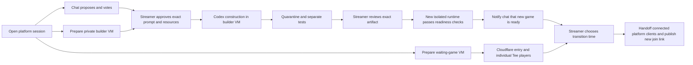

# Vibe Togueter session flow — owner specification, November 2

Vibe Togueter is the platform; its implementation remains Vibe Arena. This is the
intended experience, not a claim that every stage is integrated. The frozen delivery
remains untouched. The platform's stable public URL/custom domain and hosting are pending.

## Intended experience

1. The streamer opens a session. Chat discusses, proposes and votes. In parallel,
   separately budgeted preparation starts for a private builder VM and a waiting-game
   runtime VM. Preparing infrastructure neither approves inputs nor invokes a model.
2. The waiting-game VM starts an existing approved game such as teeworlds-rs.
   Cloudflare supplies HTTPS entry and WSS ingress. A viewer writes `!join`, opens
   the platform entry and controls their own tee with keyboard/mouse in the same
   match as the streamer. This is individual play, not a collective tee or buffs.
   VM hosting is the default; the streamer's PC is an explicit opt-in alternative,
   never an automatic outage fallback.
3. After voting/discussion and exact input/resource approval, the streamer sends
   the selected prompt to Codex in the prepared builder VM. The community keeps
   playing the waiting game. Guest login stays private; no Twitch token, streamer
   key or host auth cache enters a game VM.
4. Completed construction enters quarantine and separate testing. Model completion
   is not playable-game readiness. The source/resources, behavior report, rights
   and credits require exact streamer review. A reviewed artifact then needs its
   own isolated runtime and verified browser endpoint before a ready announcement.
5. Chat is notified when the new game is genuinely ready. The streamer chooses
   **when** to transition. Build completion never interrupts the waiting match.
   An approved handoff can notify connected platform pages and offer/switch their
   embedded game to the reviewed target.
6. Record client handoff acknowledgements. Closed tabs, detached direct-game clients
   and disconnected viewers cannot be claimed as automatically migrated; provide a
   fresh `!join` link. If target health fails, retain the waiting game. Retire only
   a platform-owned runtime after grace/deadline; never stop a separately operated
   PC development server without coordination.

teeworlds-rs is Cristóbal Muñoz's external game, developed separately with Devin and
Hermes. Its code is not attributed to Codex or the platform hackathon implementation.
The platform contribution is session/entry/hosting connection. No new boss mode,
game redesign or spectator-effect system is required for this example.

## Roles and isolation

This diagram specifies the target flow; the verification table below governs what
can be claimed today. In particular, the ready notice and session handoff are not
triggered by model completion alone.

| Resource | Responsibility | Authority |
| --- | --- | --- |
| Platform controller | Decisions, votes, credits, routing and evidence | Private streamer controls; trusted Twitch identity |
| Builder VM | Codex and exact approved inputs | Bounded allocation and fresh guest authorization |
| Waiting-game VM | Existing Tee match during construction | Game-only ingress; no coding or platform credentials |
| Test VM | Test quarantined artifact separately | Fixed harness and finite lease |
| New-game runtime | Serve the exact approved artifact | Separate allocation and runtime identity/health gates |
| Cloudflare tunnel | Temporary HTTPS/WSS transport | Not a VM, approval or hosting guarantee |

Builder and waiting-game leases are independent. Failure of one does not authorize
a replacement or extend the other. The existing worker destroys its builder before
testing in a separate guest. Runtime overlap during handoff also needs allocation.
A display name `streamer` does not authenticate a privileged game role.

## Existing versus pending

| Stage | Verified boundary |
| --- | --- |
| Proposals, ballots, selection and exact approval | Implemented/tested in Vibe Arena |
| Prepare builder during voting, renew/close/countdown | Implemented, default off; prior authorized real provider control check exists |
| Codex construction, quarantine, separate tests/review | Prior real Studio trial; no new model run authorized here; protected artifacts stay untouched |
| Individual Twitch `!join` → local Tee → ONLINE keyboard play | Verified with real command, owner confirmation and authoritative local snapshots |
| Waiting-game VM + Cloudflare + external play | Current trial objective; not yet verified |
| Session opening automatically prepares both VMs | Pending orchestration; current controls are separate |
| Generally usable runtime for newly generated artifacts | Pending; reviewed-publication evidence is not deployment |
| Ready notice and streamer-selected cross-game handoff | Pending integrated flow |
| Automatically move every viewer between arbitrary games | Not implemented; requires connected platform clients and acknowledgements |

Worker/prewarm flags stay disabled in shipped configuration. This trial concerns
one waiting-game VM only; it grants no builder, Codex call, prewarm allocation,
generated runtime or automatic provider renewal.

## Current Cloudflare trial plan

CreateOS checked at 19:23 UTC: no active guests; all 57 historical rows destroyed.
The owner chose preparation of a new VM. Railway's earlier rejected/reconciled
authorization is provider-specific and does not fund this guest. Confirm usable
CreateOS credit and obtain a fresh bounded allocation before creation/build.

Proposed: one `devbox:1`, `s-1vcpu-2gb` VM, 30 minutes from creation, USD 0.25
operator limit from existing credits, zero models/top-ups. Build isolated external
revision `0c6250d` (base `172cfef`), WASM before server. Use the narrow gateway,
disabled public admin and a loopback game listener. Run `cloudflared` **inside
the VM**, exposing only the gateway; no PC tunnel is substituted. Arm independent
cleanup before creation and verify terminal destruction afterward.

Record exact revision, contract/schema, binary/WASM hashes, HTTPS/WSS, actual input
acks, ONLINE movement, credits, disconnect/return and manual Twitch entry. Another
person/network remains a separate check. Quick Tunnel addresses are temporary,
not the platform's stable domain. If not playable by 20:00 UTC, preserve the verified
local result and disclose the missing cloud acceptance gates.

References: [builder preparation](BUILDER_PREWARM.md), [worker](STUDIO_WORKER.md),
[hosting policy](HOSTING_POLICY.md), [local integration](TEE_LOCAL_ADAPTER.md),
[Railway rejection](TEE_RAILWAY_TRIAL.md),
[Cloudflare](https://developers.cloudflare.com/tunnel/get-started/quick-tunnels/).
